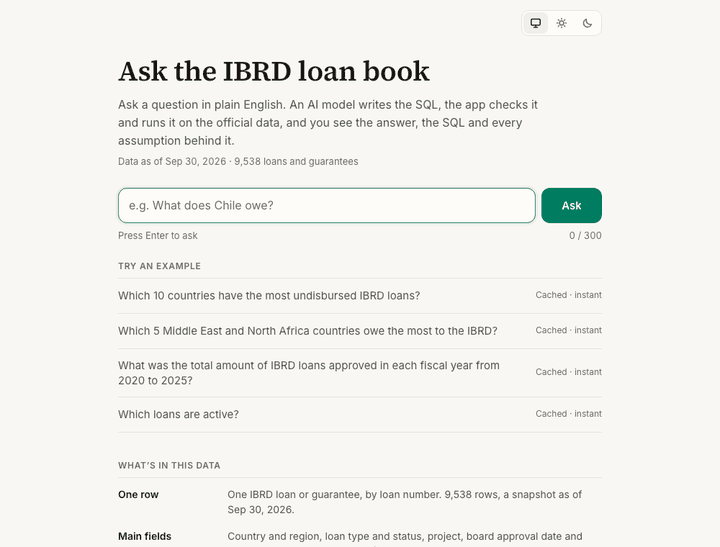
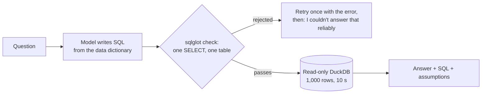

# Ask the IBRD loan book

A validated text-to-SQL analytics tool over the World Bank's IBRD loan book: ask a question in plain English, and
it shows the answer with the SQL it ran and every assumption behind it.

**Live demo:** https://ibrd-loans-sql-agent.vercel.app



## Why you can check its answers

- **Evaluated against gold answers.** 30 questions (20 dev, 10 held out) with gold SQL and expected results
  ([eval/questions.yaml](eval/questions.yaml)); every gold answer is recomputed independently with pandas from the
  raw CSV ([scripts/verify_gold.py](scripts/verify_gold.py)).
  - Dev set: **20/20** correct, caveat checks **3/3** on the current prompt
    ([run file](eval/results/20261106-143430_dev.json), [RESULTS.md](eval/RESULTS.md)).
  - Held-out set: **9/10** as first scored on Nov 1, 2026; 10/10 after a scoring rule changed *after* the result
    was seen, so 9/10 is the clean number ([RESULTS.md](eval/RESULTS.md#h07-scoring-correction-made-after-seeing-the-heldout-result)).
- **Guardrails that don't trust the model.** The SQL is parsed with sqlglot and must be exactly one `SELECT` on
  the one table; the database is opened read-only with file and network access off, 512 MB of memory, a
  1,000-row cap and a 10-second timeout. 14/14 adversarial prompts (injection, `DROP`, file reads, runaway
  queries) were stopped ([docs/security.md](docs/security.md),
  [run file](eval/results/20261103-185414_adversarial.json)).
- **It says what it assumed.** Every answer shows its SQL and lists the assumptions behind it, such as
  guarantees excluded, fiscal year, or which amount column was used. Some ambiguous questions get a clarifying question instead ("Which loans
  are active?" asks: still disbursing, or still owing?); an empty result says
  "No matching rows"; a failed query says "I couldn't answer that reliably" instead of guessing.
- **Cost caps.** 20 live questions per hour per network and 150 per day in total
  ([server/guard.py](server/guard.py)). The examples are precomputed and repeated questions come from a cache, so
  neither counts. A $10 spend cap on the API workspace is the backstop ([docs/security.md](docs/security.md)).

## How it works



The model sees one prompt built from [src/agent/data_dictionary.yaml](src/agent/data_dictionary.yaml): the
official column descriptions, the exact category values, and the rules (for example "owed" means
`borrowers_obligation_usd`). No agent framework: the pipeline is plain functions in [src/agent/](src/agent/).

## The data

- **Source:** World Bank Finances One, *IBRD Statement of Loans and Guarantees – Latest Available Snapshot*
  ([DS00047](https://financesone.worldbank.org/ibrd-statement-of-loans-and-guarantees-latest-available-snapshot/DS00047)),
  license [CC BY 4.0](https://creativecommons.org/licenses/by/4.0/).
- **Snapshot:** End of Period September 30, 2026; 9,538 rows, one per loan number
  ([data/raw/](data/raw/), frozen so the evaluation is reproducible).
- **Changes:** columns renamed to snake_case and two derived flags added (`is_guarantee`, `is_regional_entry`);
  see [scripts/build_db.py](scripts/build_db.py).
- Independent project, not affiliated with the World Bank.

## Known issues

- **Guarantees are mixed in.** Loan numbers starting `IBRDB`/`IBRDG` are guarantees (official rule), which also
  catches 20 B-loans. Loan questions exclude them by default and say so.
- **Exchange rates differ by column.** Undisbursed amounts are at end-of-period rates, disbursed and repaid at
  historical rates, the borrower's obligation is revalued; several columns don't document a basis
  (`usd_basis` in the [dictionary](src/agent/data_dictionary.yaml)).
- **Terminated loans** often show $0 original principal (38 of 79), so approved totals leave them out.
- **Regions are the current World Bank administrative regions**, even for old loans; the Middle East and North
  Africa region also includes Afghanistan and Pakistan.
- **FY2027 is a partial year** (July to September 2026).
- **Small evaluation set.** 30 questions measure the common question types, not every phrasing.
- Open and fixed issues are tracked in [docs/known-issues.md](docs/known-issues.md).

## Run it locally

Needs Python 3.12, [uv](https://docs.astral.sh/uv/), Node 22+ and an Anthropic API key in `ANTHROPIC_API_KEY`
(or `.streamlit/secrets.toml`).

```bash
uv venv --python 3.12 .venv && source .venv/bin/activate
uv pip install -r requirements-dev.txt -r server/requirements.txt
python scripts/build_db.py                 # CSV -> DuckDB in the temp dir; fails loudly if a check fails
python scripts/build_stats.py              # the page's headline numbers -> web/src/data/stats.json
pytest -q                                  # offline tests: guardrails, executor limits, API, scoring
python scripts/run_eval.py --split dev     # live: 20 questions, about $0.15

uvicorn server.main:app --port 8000        # the API
cd web && npm ci && npm run dev            # the page on http://localhost:3000 (proxies /api to :8000)
```

Locally, the rate limits and cache use memory instead of Redis.

## Stack

- **Agent:** Python 3.12, Anthropic API (`claude-sonnet-5-5`, set in [config.py](src/agent/config.py)),
  sqlglot, DuckDB
- **API:** FastAPI on Vercel, Upstash Redis for rate limits and the answer cache
- **Page:** Next.js and React, no chart library (charts are plain SVG and CSS); Playwright smoke tests in
  [web/e2e/](web/e2e/)
- [app.py](app.py) is the first version of the UI (Streamlit), kept for local use.
